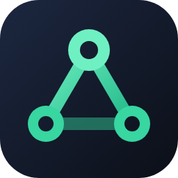

# UberConnector

A virtual LAN for playing "LAN" games over the Internet: no server, no
account, no installation (portable Windows app).

Unlike ZeroTier or Radmin, the virtual network adapter ("UberConnector")
only exists while the app runs, from the first time a salon goes into game
mode; it is removed when you quit. Games that find their lobbies through UDP broadcasts (with no IP
setting) see the other players as if they were on a real local network.

## How it works

- **Salons**: a group of players with its own secret key. You join with an
  invite code or link; admitting newcomers can be required. Moderation:
  moderators, bans with key rotation.
- **Serverless discovery**, through three paths at once:
  - **UDP BitTorrent trackers** (BEP 15): a tracker returns the addresses
    of the players already in the salon's swarm in one round trip (0.2 to
    0.6 s); each one then gets our encrypted presence record directly;
  - **Nostr**: public relays deliver an arriving player's (encrypted)
    presence record in under a second;
  - **BitTorrent DHT** (BEP44): slower, but practically impossible to take
    down; it is the fallback.
- **Direct connections** between players:
  - automatic port opening on the router (NAT-PMP / UPnP);
  - NAT hole punching (STUN, then simultaneous probes);
  - LAN address when players share a network.
- **Relaying through members**: when two players cannot reach each other
  directly, a third one who sees both relays their traffic (EasyTier mesh).
- **Salon network**: [EasyTier](https://github.com/EasyTier/EasyTier)
  encrypts the traffic. In "game mode" it uses our single Wintun adapter,
  created once by the engine and shared by whichever salon is in game mode
  (one at a time), with that salon's IP. Game
  announcements sent to 255.255.255.255 are captured and relayed into the
  salon.
- **Around it**: chat without history, game network test, per-player link
  quality, Windows notifications, `uberconnector://` invite links (with the
  web page `web/index.html`), automatic updates from GitHub releases.

## Version compatibility

**Every player of a salon needs version 0.2.0 or later to chat.** The game
network itself (virtual LAN, discovery, relaying) still works between older
and newer versions.

Up to 0.1.5, a member proved who they were in the salon chat with a fixed
signed message. Any other member of the salon could copy that message and
pass for them: write under their name, or receive what was meant for them.
Since 0.2.0 each chat link is encrypted with a key that only the two real
members can compute, fresh for every link, so a copied greeting is useless.
Closing that hole meant changing how chat links are opened, and the old way
could not be kept alongside without keeping the hole.

A 0.2.0 player sees one line in the chat naming each member who is still on
an older version; those members just need to accept the update the app
offers.

Planned improvements and the ideas set aside are in [ROADMAP.md](ROADMAP.md).

## Layout

- `crates/uc-core`: salons, discovery (DHT, Nostr, trackers), hole punching, port
  opening, EasyTier control, chat, broadcast relay, IPC protocol.
- `crates/uc-cli` → `uc-helper.exe`: the engine, with administrator rights.
  Usable from the command line or driven by the app.
- `crates/uc-app` → `UberConnector.exe`: the app (Tauri), **without
  administrator rights**. It only starts the engine (Windows permission
  prompt) when switched on, then talks to it in JSON over 127.0.0.1.
- `web/index.html`: invite link redirect page (static).
- `package.ps1`: builds `dist\UberConnector-<version>.zip`.
- `README.txt`: the user guide shipped in the zip.

## Building

Requirements: Rust (stable) on Windows.

1. Download EasyTier for Windows (tested version: 2.6.4) from
   [its releases](https://github.com/EasyTier/EasyTier/releases) and extract
   it into `vendor\easytier\easytier-windows-x86_64\`. It must contain
   `easytier-core.exe`, `easytier-cli.exe`, `wintun.dll`, `Packet.dll` and
   `WinDivert64.sys`.
2. Run `.\package.ps1`. The portable zip is written to `dist\`.

## Publishing a release (enables automatic updates)

The app looks at the latest GitHub release of `nynjardin/UberConnector`. It
offers the update when the release tag is a higher version than its own.

1. Bump `version` in the root `Cargo.toml` (the only version number), e.g.
   `0.1.0` → `0.1.1`.
2. Run `.\package.ps1`: it produces `dist\UberConnector-0.1.1.zip`.
3. On GitHub, create a release with the tag `v0.1.1`, write the changes in
   its description (shown to users as "Nouveautés"), and attach the zip
   **with this exact name**.

Drafts and pre-releases are ignored. GitHub's SHA-256 digest of the zip is
checked after download. The update keeps the user's `uc-data`.

## Testing without administrator rights

- `UC_NO_TUN=1`: no network adapter, hence no permission prompt.
- `UC_DATA_DIR`: several engine instances on one machine.
- `UC_NO_NOSTR=1`: discovery without the Nostr relays.
- `UC_NO_TRACKER=1`: discovery without the UDP BitTorrent trackers.
- `UC_NO_DIRECT=1`: no direct address in our record, so EasyTier can only
  link through the punched path (with `uc-helper … --no-port-map`, which
  opens no router port).
- `UC_ET_LOG=info`: EasyTier's log file at info level (very verbose).
- `UC_UPDATE_API`: another address instead of GitHub's release API (for
  testing updates against a local server).
- `UC_TEST_NOTIFY=1`: shows a Windows notification at start.
- `UC_TEST_NET_CHANGE=<seconds>`: acts as if the network changed after that
  delay (the session rebuilds itself).

Diagnostic tools (`cargo run -p uc-core --example <name>`):
`nat_check`, `punch_test`, `nostr_probe`, `tracker_probe`, `portmap_check`,
`discovery_probe`.

## Data

In `uc-data\`, next to the executable: the identity (private key), the salon
keys and the settings. **Never publish this folder.**

## License

UberConnector is free software under the
[GNU General Public License v3.0](LICENSE): you may use, modify and
redistribute it, as long as your version stays under the same license with
its source code available.

Additional term (GPL v3, section 7(b)): any copy or modified version must
keep the attribution **"Based on UberConnector by PaPe (nynjardin) —
https://github.com/nynjardin/UberConnector"**. See [NOTICE.txt](NOTICE.txt).

The release zip also ships [EasyTier](https://github.com/EasyTier/EasyTier),
under the [LGPL v3](licenses/LGPL-3.0.txt).
